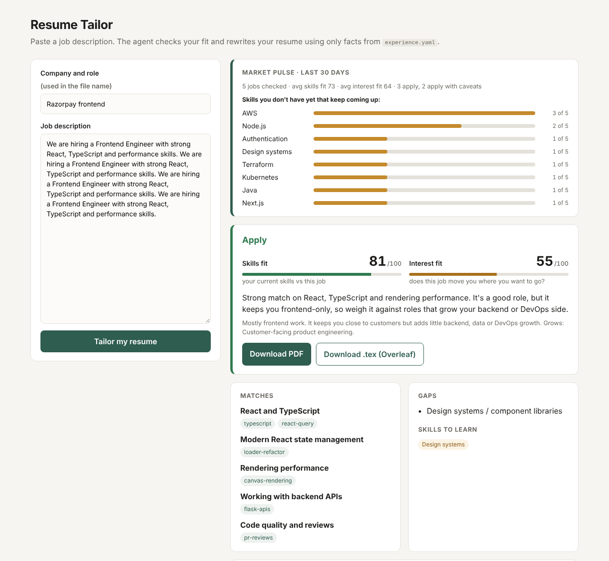

# Resume Tailor

An AI agent that reads a job description, decides whether you should apply, and rewrites your resume for it **without inventing anything**. Every claim it makes has to cite a fact from your own fact bank, and plain Python code (not the model) checks that before anything is accepted.

Built with **Python (Flask)**, **React**, and the **Anthropic Messages API with tool calling**. It runs **free on your own machine with Ollama**, or with Claude.


<sub>Screenshot from demo mode, with sample data.</sub>

## What it does

Paste a job description from LinkedIn, Wellfound or InstaHire and you get:

- **A verdict:** apply, apply with caveats, or skip, with a candid reason.
- **Two scores:**
  - **Skills fit** measures how well your *current* experience matches the job.
  - **Interest fit** measures whether the job moves you towards the areas you *want* to grow into. A strong match in an area you're trying to leave scores lower.
- **Matches and gaps:** each job requirement is mapped to your facts, and the unsupported ones are listed honestly.
- **Tailored resume bullets**, each showing the facts it's based on.
- **A resume as a `.tex` file** (for Overleaf), plus a PDF if LaTeX is installed.
- **Market pulse:** across every job you check, the skills you don't have yet that keep coming up (e.g. *"AWS: 3 of 5 jobs"*), so you know what to learn next.

## How the agent works

The model can't do anything by itself: it can only read and write text. The agent is a loop in [`backend/agent.py`](backend/agent.py) that gives the model three tools and runs them when it asks:

| Tool | What it does |
|---|---|
| `get_profile` | Returns the fact bank: skills, interests, and every fact with an id. |
| `check_bullets` | Checks draft bullets against the fact bank and lists the problems. |
| `submit_tailored_resume` | The final answer. Validated by code; rejected with a list of errors if anything fails. |

```
job description
      │
      ▼
┌─────────────────────── agent loop (max 10 turns) ───────────────────────┐
│                                                                          │
│   send full history ──► model replies ──► asks for tools?                │
│          ▲                                      │                        │
│          │                                      ▼                        │
│   tool results (or errors) ◄──────── run the tools in Python             │
│                                                 │                        │
│                         submission passes all checks? ──► stop           │
└──────────────────────────────────────────────────────────────────────────┘
      │
      ▼
verdict + scores + bullets ──► .tex / PDF ──► React UI
```

### Guardrails, enforced in code ([`backend/tools.py`](backend/tools.py))

A submission is rejected unless:
- every bullet and the summary cite fact ids that exist, and belong to the right job or project;
- **every number in a bullet appears in the facts it cites**, so the model can't turn "improved performance" into "cut load time by 35%";
- listed skills come only from the profile, and skills you're only *learning* never appear as experience;
- matched interests come from your own interests list.

When a submission fails, the errors go back to the model as a tool result with `is_error: true`, and it has to fix them and resubmit. The UI's **"What the agent did"** panel shows each step, including rejections.

## Design decisions

- **Checks live in code, not in the prompt.** A prompt is a request the model can ignore; a validator isn't. The model plans and writes, and the code decides what's accepted.
- **Least privilege.** The model can only *request* three narrow tools. It can't read files, browse or run anything else.
- **No RAG / vector database.** The whole fact bank fits in the context window, so retrieval would only add complexity. With hundreds of facts, I'd embed them and retrieve the top matches per job.
- **Stateless API, so the full history is resent each turn.** Cost grows with turns, so there's a hard cap (`MAX_TURNS = 10`).
- **Works with Claude or a local model.** Ollama supports the same Messages API, so switching is one environment variable, and the guardrails keep a smaller model honest.
- **Deterministic tests.** The agent loop is tested against a scripted fake client: parallel tool calls, rejected submissions with retries, early stops and the turn cap. The tests cost nothing and need no API key.

## Run it

**Requirements:** Python 3.9+, Node 18+, and [Ollama](https://ollama.com) (free) or an Anthropic API key.

```bash
git clone https://github.com/linettejv/resume-tailor.git && cd resume-tailor

# Backend
cd backend
python3 -m venv .venv && source .venv/bin/activate
pip install -r requirements.txt
cp data/experience.example.yaml data/experience.yaml   # then fill in your own facts

# Frontend (second terminal)
cd frontend && npm install && npm run dev               # http://localhost:5173
```

Choose a model by creating a `.env` file in the repo root:

```bash
# Free, local (recommended): install Ollama, then `ollama pull qwen3`
LLM_BASE_URL=http://localhost:11434
CLAUDE_MODEL=qwen3

# Or Claude (pay per use, from console.anthropic.com)
# ANTHROPIC_API_KEY=sk-ant-...
```

Then start the backend with `python app.py`, from `backend/` with the virtual environment active.

To try the UI with no model at all, run `DEMO=1 python app.py`, which replays a scripted run.

## Tests

```bash
cd backend && python -m pytest -q
```

19 tests cover the agent loop (with a fake client), the validation rules, LaTeX rendering and the trend analysis.

## Project structure

```
backend/
  agent.py          the tool-use loop
  tools.py          tool definitions + validation (the guardrails)
  app.py            Flask API: /api/tailor, /api/trends, /api/files
  trends.py         run history and "market pulse"
  render.py         LaTeX template → .tex / PDF
  data/             your fact bank (experience.yaml is git-ignored; see the example)
  tests/            pytest suite with a scripted fake model
frontend/src/       React UI (Vite)
```

## Limitations and next steps

- **The number check can't catch an invented claim that has no numbers in it.** Next step: a second model pass that judges each bullet against its cited facts.
- **Next: an evaluation set.** Run 10+ real job descriptions with my own verdicts, then measure how often the agent agrees, and compare Claude with a local model on the same set.
- **Smaller local models are slower and get rejected more often.** The guardrails keep their output honest, but runs take longer.

---


